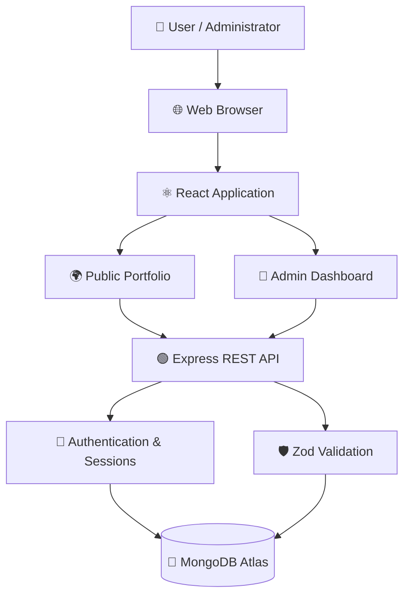
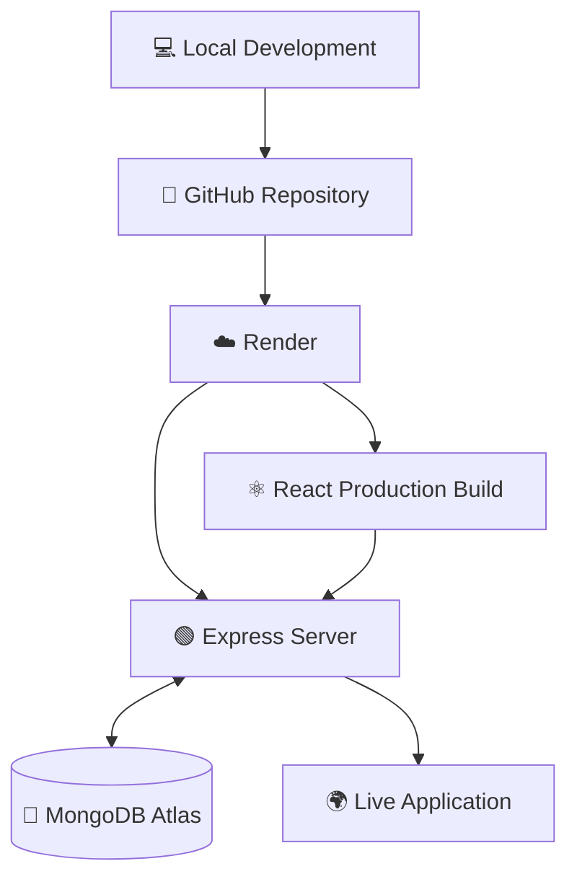

# Pradeep Chavan | Developer Portfolio

<p align="center">
  A full-stack developer portfolio built with the MERN stack, featuring a dynamic public website and a secure private admin dashboard.
</p>

<p align="center">
  <a href="https://react.dev/"></a>
  <a href="https://vite.dev/"></a>
  <a href="https://tailwindcss.com/"></a>
  <a href="https://nodejs.org/"></a>
  <a href="https://expressjs.com/"></a>
  <a href="https://www.mongodb.com/"></a>
</p>

<p align="center">
  
  
  
</p>

---

## ✨ Overview

A personal developer portfolio designed to showcase my technical skills, projects, education, certifications, and achievements through a responsive web experience.

Built using **MongoDB, Express.js, React, and Node.js**, the application combines a public portfolio with a private content-management dashboard.

Instead of hardcoding portfolio content into the frontend, the application stores it in MongoDB and retrieves it through a REST API. An authenticated administrator can manage the content directly through the dashboard without modifying the source code.

The project also emphasizes secure authentication, server-side validation, accessibility, responsive design, automated testing, and production deployment practices.

## 🚀 Features

### 🌐 Public Portfolio

- Responsive, editorial-style user interface.
- Dynamic professional profile and introduction.
- Project listings and detailed case studies.
- Technical skills organized into groups.
- Education and certification sections.
- Achievements presentation.
- Contact form with server-side validation.
- Accessible hash-based navigation.
- Responsive layouts across different screen sizes.

### 🔐 Admin Dashboard

- Private administrator authentication.
- Session-based authorization.
- Dashboard overview and statistics.
- Create, edit, and delete projects.
- Manage profile information.
- Manage skills and skill groups.
- Manage education and certifications.
- Manage achievements.
- View and manage contact messages.
- Dedicated project editor.
- Interactive workflow artwork builder.
- Live preview of project workflows.
- Unsaved-changes protection and destructive-action confirmations.

### 🛡️ Security

- Argon2id password hashing.
- MongoDB-backed session storage.
- Zod request validation.
- Helmet security headers.
- Trusted-origin verification.
- Rate limiting.
- Secure session cookies.
- XSS-safe React rendering.
- Explicit public API response projections.
- Server-side administrator authorization.

### ♿ Accessibility

- WCAG 2.2 AA engineering target.
- Semantic HTML structure.
- Keyboard-accessible interactions.
- Visible focus indicators.
- Accessible dialogs and drawers.
- Form error announcements.
- Reduced-motion support.
- Contrast-checked design tokens.

### ⚡ Performance

- Optimized Vite production build.
- Lazy-loaded administrator dashboard.
- Fingerprinted static assets.
- Immutable asset caching.
- Revalidated HTML and public API responses.
- Reduced layout shifts.
- Responsive layouts without horizontal overflow.

---

## 🏗️ Architecture

The application follows a **single-origin architecture** in production.

The React frontend communicates with an Express backend, which handles authentication, validation, business logic, and MongoDB operations.

### System Architecture



### Request Lifecycle

1. A visitor opens the portfolio.
2. React requests published content through `GET /api/portfolio`.
3. Express processes the request.
4. Mongoose retrieves the required records from MongoDB.
5. The backend returns the appropriate public data.
6. React renders the portfolio.

### Administrator Authentication Flow

1. The administrator opens `/admin/login`.
2. Credentials are submitted to the backend.
3. The password is verified using Argon2id.
4. A MongoDB-backed session is established.
5. The browser receives a protected session cookie.
6. Subsequent administrator requests are authenticated server-side.
7. Authorized content changes are persisted in MongoDB.

The administrator dashboard is lazy-loaded as a separate frontend bundle.

---

## 🎨 Project Artwork System

Projects support fixed CSS/SVG illustrations and a data-driven workflow illustration.

Existing artwork keys:

- `hostelcare`
- `aquapredict`
- `expense`

### Workflow Artwork Builder

The administrator can build project workflow diagrams through the project editor.

Supported operations:

- Add workflow steps.
- Edit existing steps.
- Remove steps.
- Reorder steps.
- Preview the workflow.

Each workflow supports between 2 and 10 steps.

| Step Type | Description |
|---|---|
| `input` | Initial input or data |
| `frontend` | Frontend processing |
| `backend` | Backend processing |
| `database` | Database operations |
| `service` | External service |
| `process` | General processing |
| `output` | Final output |

Workflow illustrations are data-driven and are not generated from project names or AI.

---

## 🧰 Technology Stack

| Layer | Technology | Purpose |
|---|---|---|
| Frontend | React 18 | Component-based interface |
| Build Tool | Vite 6 | Development and production builds |
| Styling | Tailwind CSS v4 | Utility-first styling |
| Runtime | Node.js 22 | JavaScript runtime |
| Backend | Express 5 | REST API and application server |
| Database | MongoDB | Persistent application data |
| ODM | Mongoose 9 | Database models and queries |
| Sessions | MongoDB-backed sessions | Session persistence |
| Password Hashing | Argon2id | Secure password hashing |
| Validation | Zod | Request schema validation |
| Testing | Node.js Test Runner | Automated tests |
| Deployment | Render | Application hosting |
| Database Hosting | MongoDB Atlas | Cloud database |

---

## 📁 Project Structure

```text
Portfolio/
│
├── backend/
│   ├── scripts/
│   ├── src/
│   │   ├── config/
│   │   ├── middleware/
│   │   ├── models/
│   │   ├── routes/
│   │   ├── scripts/
│   │   └── validation/
│   ├── tests/
│   └── package.json
│
├── frontend/
│   ├── public/
│   │   ├── favicon
│   │   ├── resume.pdf
│   │   └── robots.txt
│   ├── src/
│   │   ├── admin/
│   │   ├── api/
│   │   ├── components/
│   │   ├── data/
│   │   ├── sections/
│   │   ├── App.jsx
│   │   └── main.jsx
│   ├── tests/
│   └── package.json
│
├── docs/
│   ├── ARCHITECTURE.md
│   ├── PROJECT_GUIDE.md
│   └── INTERVIEW_PREPARATION.md
│
├── .env.example
├── .gitignore
├── .node-version
├── render.yaml
└── package.json
```

---

## ⚙️ Getting Started

### Prerequisites

Install the following before running the application:

- Node.js 20.19.0 or later.
- Node.js 22.20.0 is the tested version.
- npm with lockfile support.
- MongoDB locally or a MongoDB Atlas cluster.

Verify your installation:

```bash
node --version
npm --version
```

### 1. Clone the Repository

```bash
git clone <YOUR_GITHUB_REPOSITORY_URL>
cd Portfolio
```

### 2. Install Dependencies

```bash
npm run install:all
```

Alternatively, install packages separately:

```bash
npm --prefix frontend ci --include=dev
npm --prefix backend ci
```

### 3. Configure Environment Variables

Create your local environment file.

**Windows PowerShell:**

```powershell
Copy-Item .env.example .env
```

**macOS / Linux:**

```bash
cp .env.example .env
```

Configure the required variables:

| Variable | Description |
|---|---|
| `NODE_ENV` | Application environment |
| `PORT` | Backend server port |
| `MONGODB_URI` | MongoDB connection string |
| `SESSION_SECRET` | Secret for signing administrator sessions |
| `TRUST_PROXY` | Reverse-proxy trust configuration |
| `CLIENT_ORIGIN` | Optional frontend origin for separate-origin deployments |

Generate a secure session secret:

```bash
node -e "console.log(require('node:crypto').randomBytes(48).toString('base64'))"
```

Never commit `.env` or expose database credentials.

### 4. Configure MongoDB

The application supports both local MongoDB and MongoDB Atlas.

**Local MongoDB example:**

```text
mongodb://127.0.0.1:27017/pradeep_portfolio
```

**MongoDB Atlas example:**

```text
mongodb+srv://<username>:<password>@<cluster-host>/<database>?retryWrites=true&w=majority
```

Store the actual connection string in `.env`.

### 5. Start the Application

Run the backend:

```bash
npm run dev:server
```

Run the frontend in a second terminal:

```bash
npm run dev:frontend
```

Open:

```text
http://localhost:5173
```

The Vite development server proxies `/api` requests to the backend, normally running at:

```text
http://localhost:4000
```

---

## 🌱 Database Seeding

The application includes an idempotent content-seeding script.

Run:

```bash
npm run seed:content
```

The script:

- Creates initial records when their stable keys are absent.
- Avoids overwriting content edited through the dashboard.
- Does not automatically delete removed records.
- Avoids duplicate records when executed repeatedly.

The seed script manages initial profile, project, and skill-group content.

Education, certifications, and achievements can be managed through the dashboard.

Review existing data before running the seed script against a production database.

---

## 👤 Administrator Setup

Administrator accounts are not created automatically.

Create the first administrator:

```bash
npm run admin:create
```

You can also provide the administrator's identity:

```bash
npm run admin:create -- --email <your-email> --name "<your-name>"
```

The password is entered through a hidden interactive prompt and must contain at least 12 characters.

After creating the administrator, open:

```text
/admin/login
```

Sign in using the configured credentials.

### Account Lockout Recovery

Ten consecutive failed sign-in attempts lock an administrator account for 15 minutes.

To clear a lockout from a trusted deployment terminal:

```bash
npm run admin:unlock -- --email <your-email>
```

This resets the failed-attempt counter and lockout timestamp without changing the password or session data.

---

## 🔌 API Overview

The Express backend exposes public, authentication, and administrator endpoints.

### Public Endpoints

| Method | Endpoint | Description |
|---|---|---|
| GET | `/api/health` | Service and database health |
| GET | `/api/portfolio` | Retrieve published portfolio content |
| POST | `/api/contact` | Submit a contact message |

### Authentication Endpoints

| Method | Endpoint | Description |
|---|---|---|
| POST | `/api/auth/login` | Administrator login |
| GET | `/api/auth/me` | Retrieve current administrator |
| POST | `/api/auth/logout` | End administrator session |

### Administrator Endpoints

All administrator endpoints require authentication. State-changing requests also require trusted-origin verification.

| Resource | Supported Operations |
|---|---|
| Overview | `GET /api/admin/overview` |
| Projects | `GET`, `POST`, `PATCH`, `DELETE` |
| Messages | `GET`, `PATCH`, `DELETE` |
| Skill Groups | `GET`, `POST`, `PATCH`, `DELETE` |
| Education | `GET`, `POST`, `PATCH`, `DELETE` |
| Certifications | `GET`, `POST`, `PATCH`, `DELETE` |
| Achievements | `GET`, `POST`, `PATCH`, `DELETE` |
| Profile | `GET`, `PUT` |

Resource-specific operations use their corresponding collection or `:id` routes.

Unknown `/api/*` routes return JSON errors instead of the frontend HTML. Missing static assets also return proper 404 responses.

---

## 🛡️ Security

Security is implemented across authentication, API validation, session management, and data access.

### Authentication & Password Protection

- Argon2id password hashing.
- Password hashes are never returned by the API.
- Dummy verification for unknown-account login attempts.
- Server-side authorization for administrator routes.
- Session ID regeneration after successful login.

### Session Management

- MongoDB-backed session storage.
- `HttpOnly` session cookies.
- `SameSite=Lax`.
- `Secure` cookies in production.
- Approximately eight-hour session expiration.
- No in-memory session-store fallback.

### Input Validation

Zod schemas validate incoming requests and reject:

- Unknown request properties.
- Unsupported nested objects.
- Mass-assignment fields such as `_id` and `__v`.
- Invalid URLs.
- Unsupported URL schemes such as `javascript:`, `data:`, and `vbscript:`.

### XSS Protection

Application content is rendered through React text nodes.

The application source contains no:

- `dangerouslySetInnerHTML`
- `innerHTML`
- `outerHTML`
- `document.write`
- `eval`
- `new Function`

Regression tests check hostile HTML payloads and ensure they remain inert text.

### HTTP Security

Helmet provides security headers, including:

- Content Security Policy.
- `X-Content-Type-Options: nosniff`.
- `X-Frame-Options: SAMEORIGIN`.
- `Referrer-Policy: no-referrer`.

Additional protections include disabled `x-powered-by`, JSON-only API request handling, and a 32 KB JSON request-body limit.

### Rate Limiting

| Protection | Limit |
|---|---|
| Login attempts | 5 per IP per 15 minutes |
| Account lockout | 10 consecutive failures for 15 minutes |
| Contact submissions | 5 per IP per hour |

The contact form also uses a hidden honeypot and minimum form age. Spam submissions receive the same response as accepted submissions and are not stored.

---

## ♿ Accessibility

The application follows WCAG 2.2 AA as an engineering target.

Implemented accessibility considerations include:

- Semantic HTML landmarks.
- Logical heading structure.
- Keyboard-accessible controls.
- Visible focus indicators.
- Skip navigation.
- Accessible dialogs and drawers.
- Managed focus and focus restoration.
- Escape-key dialog dismissal.
- Accessible form validation.
- Screen-reader status announcements.
- Reduced-motion support.
- Contrast checks for normal and large text.
- Minimum 48 × 48 pixel targets for navigation and primary actions.

Automated checks do not replace a complete manual screen-reader or assistive-technology audit. WCAG compliance should not be claimed without appropriate verification.

---

## ⚡ Performance

The production frontend uses Vite's optimized build pipeline.

Performance-related implementation includes:

- Lazy loading of the administrator dashboard.
- Fingerprinted static assets.
- One-year immutable caching for fingerprinted assets.
- HTML revalidation.
- Public API response revalidation.
- `no-store` caching for authentication and administrator responses.
- Responsive layouts designed to avoid horizontal overflow.

### Cumulative Layout Shift

Reported Chromium measurements:

| Viewport | Measured CLS | Target |
|---|---:|---:|
| Mobile — 375px | 0.000147 | < 0.05 |
| Desktop — 1440px | 0.000100 | < 0.05 |

### Responsive Verification

| Viewport | Result |
|---|---|
| 280px | No horizontal overflow |
| 375px | No horizontal overflow |
| 1440px | No horizontal overflow |
| 2560px | No horizontal overflow |

LCP and INP still require validation through Lighthouse or real-user field data after deployment.

These figures represent reported local measurements, not live production measurements.

---

## 🧪 Testing

The project uses Node.js's built-in test runner.

Run the complete test suite:

```bash
npm test
```

Run individual suites:

```bash
npm run test:server
npm run test:frontend
```

### Reported Test Results

| Test Suite | Tests | Result |
|---|---:|---|
| Frontend | 196 | Passed |
| Backend | 122 | Passed |
| **Total** | **318** | **318/318 reported passed** |

The frontend suite uses jsdom and Vite's SSR module loader to test component markup, focus behavior, and API-client contracts.

The backend suite includes API, authentication, validation, logger, and production-serving checks.

Backend integration tests require MongoDB and use isolated test databases. Test database names must end in `_test`.

The test suites refuse to run against the real `pradeep_portfolio` database.

**Never use the production database for test writes.**

### QA Methodology

The application was reviewed through nine QA gates:

| Gate | Focus |
|---|---|
| 1 | Static integrity |
| 2 | Public experience |
| 3 | Admin authentication |
| 4 | Content administration |
| 5 | Production serving and SEO |
| 6 | Resilience |
| 7 | Accessibility |
| 8 | Data normalization and URL safety |
| 9 | Security and release verification |

A final UI-polish regression pass additionally covers navigation indicators, focus treatment, contact interactions, reduced-motion card behavior, and the editorial background mesh.

---

## ☁️ Deployment

The application is designed for deployment on Render with MongoDB Atlas.

### Deployment Architecture



### Deployment Steps

1. Push the project repository to GitHub.
2. Create a MongoDB Atlas cluster.
3. Configure the database user and network access.
4. Connect the GitHub repository to Render.
5. Configure the service using `render.yaml`.
6. Add `MONGODB_URI` as a secret environment variable.
7. Configure or generate a strong `SESSION_SECRET`.
8. Configure `TRUST_PROXY` for the trusted Render proxy.
9. Allow Render to install dependencies and build the frontend.
10. Verify the deployment through the health endpoint.
11. Seed production content if required.
12. Create the production administrator.

### Production Build

Build the frontend:

```bash
npm run build:frontend
```

Start the application:

```bash
npm start
```

Express serves the API and built frontend from the same origin.

The production server refuses to start without a frontend build.

Render supplies the `PORT` environment variable.

### Deployment Verification

After deployment, verify:

```text
/api/health
```

Also check:

```text
/
/admin/login
```

A successful local build does not guarantee a successful remote deployment. Always inspect deployment logs and verify the live application.

---

## 📚 Documentation

Additional project documentation:

| Document | Description |
|---|---|
| `docs/PROJECT_GUIDE.md` | Owner workflow, editor, seeding, and troubleshooting |
| `docs/ARCHITECTURE.md` | Request flow, authentication, contact, and deployment |
| `docs/INTERVIEW_PREPARATION.md` | Technical explanations and interview preparation |
| `frontend/docs/structure-guide.md` | Frontend structure and component responsibilities |
| `frontend/docs/design-notes.md` | Visual and interaction decisions |
| `.env.example` | Environment configuration reference |
| `render.yaml` | Render deployment configuration |

---

## ⚠️ Known Limitations

- MongoDB is required for portfolio content and administrator authentication.
- The administrator area is designed as a single-owner tool.
- Public administrator registration is not supported.
- A password-reset flow is not implemented.
- A role hierarchy is not implemented.
- Automated accessibility checks do not replace manual assistive-technology testing.
- Linux native module builds are not verified by local Windows checks; Argon2 must install successfully in the deployment environment.
- LCP and INP require further validation using Lighthouse or real-user data.
- Live deployment status must be verified independently.

---

## 👨‍💻 Author

**Pradeep Chavan**

Full-Stack Development | Problem Solving | Software Engineering

This project reflects my work in frontend development, backend architecture, database integration, authentication, security, testing, and deployment.

---

<p align="center">
  <strong>Built with curiosity, consistency, and a passion for learning.</strong>
  <br />
  ⭐ Thanks for exploring my project!
</p>