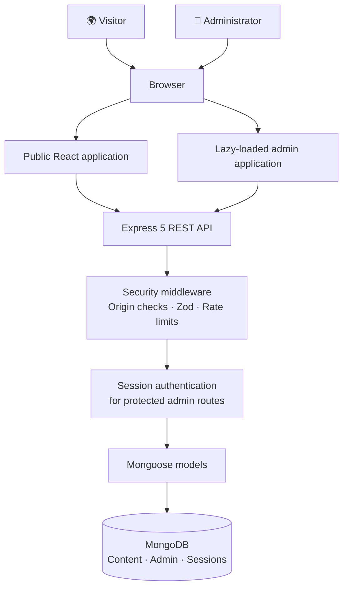
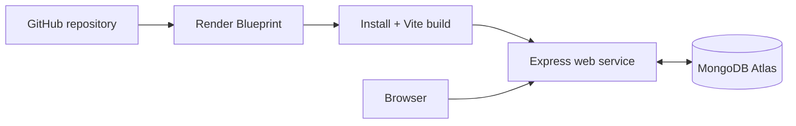

<!--
  Pradeep Chavan — Developer Portfolio
  Keep project claims aligned with the implementation and measured results.
-->

<h1 align="center">Pradeep Chavan · Developer Portfolio</h1>

<p align="center">
  A full-stack developer portfolio with a dynamic public website and a private,
  session-authenticated content management dashboard.
</p>

<p align="center">
  <a href="https://react.dev/"></a>
  <a href="https://vite.dev/"></a>
  <a href="https://tailwindcss.com/"></a>
  <a href="https://nodejs.org/"></a>
  <a href="https://expressjs.com/"></a>
  <a href="https://www.mongodb.com/"></a>
  <a href="https://mongoosejs.com/"></a>
</p>

<p align="center">
  
  
  
</p>

<p align="center">
  <a href="#-overview">Overview</a> ·
  <a href="#-features">Features</a> ·
  <a href="#-architecture">Architecture</a> ·
  <a href="#-getting-started">Getting Started</a> ·
  <a href="#-testing">Testing</a> ·
  <a href="#-deployment">Deployment</a>
</p>

---

## ✨ Overview

This is my personal developer portfolio, built to present my projects, technical skills, education, certifications, and achievements through a responsive web experience.

The application has two connected interfaces:

- **Public portfolio** — visitors can explore my work and contact me.
- **Private admin dashboard** — I can manage portfolio content without editing frontend source files.

Portfolio content is stored in MongoDB and served through an Express REST API. The administrator dashboard uses server-side session authentication, with passwords hashed using Argon2id.

The project is also an exercise in building a maintainable full-stack application: separating frontend and backend responsibilities, validating API input, protecting sessions, testing important behaviour, and preparing a single-origin production deployment.

## 🚀 Features

<table>
  <tr>
    <td width="50%" valign="top">
      <h3>🌐 Public portfolio</h3>
      <ul>
        <li>Responsive, editorial-style interface</li>
        <li>Dynamic profile and introduction</li>
        <li>Database-driven project showcase and case studies</li>
        <li>Grouped technical skills</li>
        <li>Education, certifications, and achievements</li>
        <li>Validated contact form</li>
        <li>Accessible section navigation</li>
      </ul>
    </td>
    <td width="50%" valign="top">
      <h3>🔐 Admin dashboard</h3>
      <ul>
        <li>Private administrator sign-in</li>
        <li>MongoDB-backed sessions</li>
        <li>Dashboard overview</li>
        <li>Manage projects and profile</li>
        <li>Manage skills and skill groups</li>
        <li>Manage education and certifications</li>
        <li>Manage achievements and messages</li>
        <li>Dedicated project editor and workflow builder</li>
      </ul>
    </td>
  </tr>
  <tr>
    <td width="50%" valign="top">
      <h3>🛡️ Security</h3>
      <ul>
        <li>Argon2id password hashing</li>
        <li>Server-side authorization</li>
        <li>Zod request validation</li>
        <li>Helmet security headers</li>
        <li>Trusted-origin checks</li>
        <li>Rate limiting and account lockout</li>
        <li>Secure, HTTP-only session cookies</li>
      </ul>
    </td>
    <td width="50%" valign="top">
      <h3>⚡ Quality and performance</h3>
      <ul>
        <li>Lazy-loaded admin application bundle</li>
        <li>Fingerprint-based asset caching</li>
        <li>Reduced-motion support</li>
        <li>Keyboard-friendly controls and dialogs</li>
        <li>Responsive layout checks</li>
        <li>Automated frontend and backend tests</li>
        <li>Production static-file and API handling</li>
      </ul>
    </td>
  </tr>
</table>

## 🏗️ Architecture

The production application uses a **single-origin architecture**: Express serves the built React application and the REST API from the same web service.



### Main request flows

**Public portfolio**

1. The browser loads the React public application.
2. The frontend requests `GET /api/portfolio`.
3. Express retrieves approved public fields from MongoDB through Mongoose.
4. The API returns published portfolio content.
5. React normalizes the response and renders the page.

**Administrator**

1. The administrator signs in through `POST /api/auth/login`.
2. The backend validates the request and verifies the Argon2id password hash.
3. A server-side session is created and the session ID is rotated.
4. The browser receives an HTTP-only session cookie.
5. Protected API requests are independently authenticated on the server.

The admin application is loaded separately for `/admin/*`; public visitors do not need to download the dashboard bundle.

### Data is authoritative

The public portfolio treats MongoDB as the source of truth for managed content. Empty or unavailable project and skill collections are not silently replaced with old bundled records. This avoids deleted or unpublished content unexpectedly reappearing.

## 🎨 Project workflow artwork

Projects can use one of the existing CSS/SVG illustrations or a data-driven workflow diagram.

The project editor's workflow builder supports:

- Adding, editing, removing, and reordering steps.
- A live preview while editing.
- Between 2 and 10 steps per workflow.
- Controlled step types: `input`, `frontend`, `backend`, `database`, `service`, `process`, and `output`.

The diagram is rendered from the workflow data saved with the project. It is not AI-generated and does not infer an architecture from a project title.

## 🧰 Technology stack

| Layer | Technology | Role |
|---|---|---|
| UI | React 18 | Component-based frontend |
| Routing | React Router 7 | Admin dashboard routing |
| Build | Vite 6 | Development server and production build |
| Styling | Tailwind CSS 4 | Utility-first styling |
| Runtime | Node.js | JavaScript runtime |
| API | Express 5 | REST API and production server |
| Database | MongoDB | Portfolio and account data |
| ODM | Mongoose 9 | Models and database access |
| Sessions | express-session + connect-mongo | Persistent server-side sessions |
| Passwords | Argon2id | Password hashing and verification |
| Validation | Zod 4 | Request validation |
| Security | Helmet, express-rate-limit | HTTP hardening and rate limiting |
| Tests | Node.js built-in test runner | Frontend and backend tests |
| Hosting | Render | Single-web-service deployment |
| Database hosting | MongoDB Atlas | Managed MongoDB deployment |

## 📁 Repository structure

```text
pradeep-chavan-portfolio/
├── backend/
│   ├── scripts/                 # Content seeding and admin creation
│   ├── src/
│   │   ├── config/              # Environment, database, session, auth
│   │   ├── lib/                 # Shared helpers and utilities
│   │   ├── middleware/          # Auth, origin, rate limit, errors
│   │   ├── models/              # Mongoose models
│   │   ├── routes/              # Public and admin API routes
│   │   ├── scripts/             # Admin lockout recovery
│   │   └── validation/          # Zod schemas
│   ├── tests/
│   └── package.json
├── frontend/
│   ├── public/                  # Favicon, resume, robots.txt
│   ├── src/
│   │   ├── admin/               # Admin pages, editor, API wrappers
│   │   ├── api/                 # Public API clients and normalization
│   │   ├── components/          # Shared UI and artwork
│   │   ├── data/                # Portfolio data helpers
│   │   ├── pages/
│   │   ├── sections/            # Public portfolio sections
│   │   ├── App.jsx
│   │   └── main.jsx
│   ├── tests/
│   ├── docs/
│   └── package.json
├── docs/
│   ├── ARCHITECTURE.md
│   ├── PROJECT_GUIDE.md
│   └── INTERVIEW_PREPARATION.md
├── .env.example
├── .gitignore
├── .node-version
├── render.yaml
└── package.json
```

## ⚙️ Getting started

### Prerequisites

- Node.js **20.19.0 or later**.
- Node.js **22.20.0** is the version recorded as tested for this project.
- npm.
- A local MongoDB instance or a MongoDB Atlas database.

Check your installed versions:

```bash
node --version
npm --version
```

### 1. Clone the repository

```bash
git clone https://github.com/Pradeep4002-C/pradeep-chavan-portfolio.git
cd pradeep-chavan-portfolio
```

### 2. Install dependencies

Run this from the repository root:

```bash
npm run install:all
```

This installs the frontend and backend dependencies using their lockfiles.

### 3. Configure environment variables

Create a local `.env` file from the example.

**Windows PowerShell**

```powershell
Copy-Item .env.example .env
```

**macOS / Linux**

```bash
cp .env.example .env
```

Set the values for your environment:

| Variable | Purpose |
|---|---|
| `NODE_ENV` | Runtime environment: development, production, or test |
| `PORT` | Local API port; defaults to 4000 in the example |
| `TRUST_PROXY` | Set true only behind the one trusted reverse proxy |
| `MONGODB_URI` | MongoDB connection string |
| `SESSION_SECRET` | Secret used to sign administrator session cookies |
| `CLIENT_ORIGIN` | Optional trusted frontend origin for separate-origin setups |

Generate a strong session secret:

```bash
node -e "console.log(require('node:crypto').randomBytes(48).toString('base64'))"
```

Keep your real `.env` private. Do not commit database credentials or session secrets.

### 4. Configure MongoDB

For a local MongoDB instance, the example URI is:

```text
mongodb://127.0.0.1:27017/pradeep_portfolio
```

For MongoDB Atlas, use the connection string supplied by Atlas:

```text
mongodb+srv://<username>:<password>@<cluster-host>/<database>?retryWrites=true&w=majority
```

Put your actual URI in `.env`. Ensure the database user and network access rules allow the application to connect.

### 5. Start the application

Open two terminals at the repository root.

**Terminal 1 — backend**

```bash
npm run dev:server
```

**Terminal 2 — frontend**

```bash
npm run dev:frontend
```

Open the Vite development URL:

```text
http://localhost:5173
```

The Vite development server proxies `/api` requests to the Express server, which uses port `4000` by default in the example environment.

## 🌱 Initial content and administrator setup

### Seed initial portfolio content

```bash
npm run seed:content
```

The content seed is designed to be idempotent: it creates initial records when their stable keys are absent and avoids overwriting content already edited through the dashboard. Review the target database before running it, especially in production.

### Create the administrator

Administrator accounts are not created automatically. Create the first account from a trusted terminal:

```bash
npm run admin:create
```

You can supply the account identity:

```bash
npm run admin:create -- --email <your-email> --name "<your-name>"
```

The password is entered through a hidden interactive prompt and must contain at least 12 characters.

Then visit:

```text
http://localhost:5173/admin/login
```

### Recover an administrator lockout

After ten consecutive failed sign-in attempts, an account is locked for 15 minutes. From a trusted deployment terminal, an owner can clear the lockout counter:

```bash
npm run admin:unlock -- --email <your-email>
```

This does not change the password or delete session data.

## 🔌 API overview

### Public routes

| Method | Endpoint | Purpose |
|---|---|---|
| GET | `/api/health` | Service and database health check |
| GET | `/api/portfolio` | Retrieve approved public portfolio content |
| POST | `/api/contact` | Submit a contact message |

### Authentication routes

| Method | Endpoint | Purpose |
|---|---|---|
| POST | `/api/auth/login` | Sign in an administrator |
| GET | `/api/auth/me` | Get the current administrator session |
| POST | `/api/auth/logout` | End the administrator session |

### Administrator routes

All routes below require an authenticated administrator. State-changing requests are also subject to trusted-origin checks.

| Resource | Collection endpoint | Item endpoint |
|---|---|---|
| Overview | `GET /api/admin/overview` | — |
| Projects | `GET, POST /api/admin/projects` | `GET, PATCH, DELETE /api/admin/projects/:id` |
| Messages | `GET /api/admin/messages` | `PATCH, DELETE /api/admin/messages/:id` |
| Skill groups | `GET, POST /api/admin/skill-groups` | `PATCH, DELETE /api/admin/skill-groups/:id` |
| Education | `GET, POST /api/admin/education` | `PATCH, DELETE /api/admin/education/:id` |
| Certifications | `GET, POST /api/admin/certifications` | `PATCH, DELETE /api/admin/certifications/:id` |
| Achievements | `GET, POST /api/admin/achievements` | `PATCH, DELETE /api/admin/achievements/:id` |
| Profile | `GET, PUT /api/admin/profile` | — |

Unknown API paths return JSON errors rather than the frontend HTML. The production server also handles static assets and browser-side application routes.

## 🛡️ Security notes

Security is enforced on the server; hiding dashboard screens in the browser is not treated as authorization.

- **Password storage:** administrator passwords are hashed and verified with Argon2id.
- **Session storage:** sessions are stored in MongoDB; there is no in-memory production fallback.
- **Session cookies:** HTTP-only, `SameSite=Lax`, and secure in production.
- **Session lifecycle:** the session ID is regenerated after successful authentication.
- **Authorization:** protected administrator API routes verify the session server-side.
- **Validation:** Zod schemas validate request bodies and reject unsupported properties.
- **Origin protection:** state-changing requests are checked against the trusted origin.
- **HTTP headers:** Helmet supplies security headers, including Content Security Policy.
- **Rate limiting:** login and contact endpoints have request limits.
- **Account lockout:** repeated failed administrator logins trigger a temporary lockout.
- **Public data:** API responses use approved public fields rather than exposing complete database documents.
- **Rendering:** user-provided content is rendered as React text; the application avoids injecting raw HTML.

The contact form also uses a honeypot and minimum form-age checks to reduce automated submissions. These controls reduce abuse; they do not guarantee that all spam will be blocked.

## ♿ Accessibility and responsive design

Accessibility is an engineering target throughout the interface, not a claim of independently certified compliance.

- Semantic landmarks and logical heading structure.
- Keyboard-accessible controls and visible focus indicators.
- Skip navigation.
- Accessible dialogs and drawers, including focus handling.
- Form error and status announcements.
- Reduced-motion support.
- Contrast-checked design tokens.
- Responsive layouts checked at narrow and wide viewport sizes.

The project documentation records a **WCAG 2.2 AA target**. Automated tests and contrast checks do not replace a complete manual audit with screen readers and other assistive technologies.

## ⚡ Performance and layout verification

The production frontend uses Vite's build pipeline, lazy-loads the admin application, and uses fingerprinted assets for long-lived immutable caching. HTML and public API responses are revalidated; authentication and admin responses use non-cacheable policies.

### Reported local CLS measurements

| Viewport | Reported CLS | Reference target |
|---|---:|---:|
| Mobile — 375px | 0.000147 | < 0.05 |
| Desktop — 1440px | 0.000100 | < 0.05 |

The project documentation also records no horizontal overflow at 280px, 375px, 1440px, and 2560px viewports.

These are **reported local measurements**, not live production field data. Largest Contentful Paint (LCP) and Interaction to Next Paint (INP) still need validation after deployment using Lighthouse or real-user monitoring.

## 🧪 Testing

The project uses Node.js's built-in test runner.

Run all suites from the repository root:

```bash
npm test
```

Run suites individually:

```bash
npm run test:server
npm run test:frontend
```

### Previously reported results

| Suite | Reported tests |
|---|---:|
| Frontend | 196 |
| Backend | 122 |
| **Total** | **318** |

The **318-test figure is a previously reported result** and should be treated as a checkpoint, not a guarantee of the current test count. Run `npm test` to verify the current repository state.

Backend integration tests use isolated test databases. Test database names must end in `_test`; the test suite is designed to refuse writes to the real `pradeep_portfolio` database. Never point test runs at production data.

### QA review areas

The project's documented QA process covers:

1. Static integrity.
2. Public portfolio experience.
3. Admin authentication.
4. Content administration.
5. Production serving and SEO.
6. Resilience and error states.
7. Accessibility.
8. Data normalization and URL safety.
9. Security and release verification.

A separate UI-polish regression pass covers navigation indicators, focus treatment, contact interactions, reduced-motion behaviour, and visual styling.

## ☁️ Deployment

The repository includes a Render Blueprint at `render.yaml`. It describes one Node web service that builds the frontend and starts Express; it is not a separate frontend and backend deployment.



### Render configuration

The checked-in Blueprint configures:

- Node web service named `pradeep-portfolio`.
- Free plan.
- Build command: `npm run install:all && npm run build:frontend`.
- Start command: `npm start`.
- Health check: `/api/health`.
- `NODE_ENV=production`.
- `TRUST_PROXY=true` for the configured single trusted Render proxy.
- `MONGODB_URI` supplied privately in the Render dashboard.
- `SESSION_SECRET` generated by Render.

Render supplies the `PORT` environment variable automatically. Do not commit real secrets to `render.yaml`, the README, or source control.

### Manual production commands

Build the frontend:

```bash
npm run build:frontend
```

Start the production server:

```bash
npm start
```

Express serves the built frontend and API from the same origin. The production server expects the frontend build to exist.

### Deployment checklist

1. Create a MongoDB Atlas cluster and database user.
2. Configure Atlas network access for the hosting environment.
3. Connect this GitHub repository to Render using the Blueprint workflow.
4. Supply `MONGODB_URI` securely and confirm `SESSION_SECRET` is generated.
5. Deploy and inspect the build and runtime logs.
6. Check `/api/health`.
7. Open the public site and `/admin/login`.
8. Seed initial content if needed and create the administrator using the trusted deployment shell.
9. Test sign-in, content editing, contact submission, page refresh, and mobile layouts.

A successful local build does not guarantee a successful hosted deployment. Verify the live service and its logs after each deployment.

## 📚 Further documentation

| Document | What it covers |
|---|---|
| [Project guide](docs/PROJECT_GUIDE.md) | Owner workflow, dashboard usage, seeding, and troubleshooting |
| [Architecture](docs/ARCHITECTURE.md) | Request paths, authentication, data flow, and production serving |
| [Interview preparation](docs/INTERVIEW_PREPARATION.md) | Project walkthrough and implementation decisions |
| [Frontend structure guide](frontend/docs/structure-guide.md) | Frontend folders and component responsibilities |
| [Frontend design notes](frontend/docs/design-notes.md) | Visual direction and interaction decisions |
| [Environment example](.env.example) | Environment variable reference |
| [Render Blueprint](render.yaml) | Single-service deployment configuration |

## ⚠️ Known limitations

- MongoDB is required for portfolio content and administrator authentication.
- The admin area is designed as a single-owner tool; public registration is not supported.
- A password-reset flow and role hierarchy are not implemented.
- Accessibility work is an engineering target; a full manual assistive-technology audit remains necessary.
- LCP and INP have not been established through production field data.
- Native dependency installation, including Argon2, must succeed in the deployment environment; local Windows checks alone do not prove Linux deployment compatibility.
- The README does not claim a live production deployment. Confirm deployment status independently.

## 👨‍💻 Author

**Pradeep Chavan**  
Computer Science Engineering Student · Full-Stack Developer

Interested in full-stack development, problem solving, and building practical software.

---

<p align="center">
  <strong>Built with curiosity, consistency, and a passion for learning.</strong><br>
  Thanks for taking the time to explore my work! ✨
</p>
